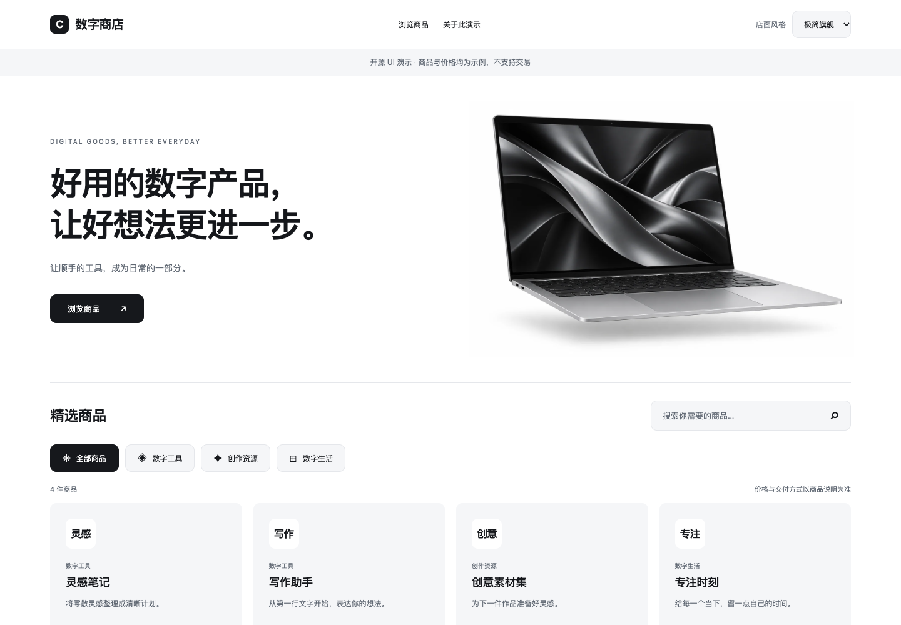

# Coco9 Storefront UI

六套可独立运行、无需框架的数字商品商店 UI。原生 HTML / CSS / JavaScript，无运行时依赖。

| 风格 | 设计身份 | 兼容 ID |
| --- | --- | --- |
| 极简旗舰 | minimal | minimal |
| 暗黑科技 | orbital | dark-business |
| 生活方式 | warm | card-catalog |
| 游戏像素 | arcade | compact-list |
| 杂志极简 | editorial | editorial |
| 赛博霓虹 | neon | playful |



截图：[暗黑科技](docs/orbital.png) · [生活方式](docs/warm.png) · [游戏像素](docs/arcade.png) · [杂志极简](docs/editorial.png) · [赛博霓虹](docs/neon.png)

## 本地运行

安装 Node.js 20 或以上，执行：

```sh
npm start
```

打开 `http://127.0.0.1:5173`。无需 `npm install`。支持 `PORT=5180 npm start` 指定端口，也可以部署到任意静态托管服务。

右上角切换主题。搜索、分类和商品详情可交互；风格选择只保存在演示站当前浏览器中。这里全部是合成商品和价格，没有交易能力。

## 接入自己的业务

```js
import {renderStorefront, renderProduct, themeFor} from './src/index.js';
const theme = themeFor('orbital');
document.body.classList.add('storefront');
document.body.dataset.design = theme.design;
document.body.dataset.template = theme.id;
main.innerHTML = renderStorefront({
  template: theme.id,
  brand: '你的店名',
  categories: [{id: 'tools', name: '数字工具'}],
  assetBase: './src/assets',
});
main.querySelector('.products').innerHTML = renderProduct({
  name: '你的商品',
  category: '数字工具',
  description: '来自真实商品接口的说明',
  price: '20.00 USDT',
  image: '/images/product.webp',
  href: '#/product/your-product',
  soldOut: false,
}, theme.id);
```

加载 `src/styles.css`，由宿主提供基础布局规则；`demo.css` 是可参考的最小整页样式。`demo.js` 展示搜索、分类、主题切换和移动菜单接线方式。主题资产路径可配置；`heroTitle` 可用 `\n` 指定标题换行。

商品名、价格、分类等文本均转义。图片只接受站内绝对路径或 HTTPS；商品链接限制为 `#/product/`。如采用其他路由，请在宿主适配层转换，不要拼接未转义的 HTML。

UI 不请求 API、不保存账户凭证、不计算结算金额、不处理支付。把 `data-category`、`.search`、`data-catalog-jump` 和商品链接接到现有业务；价格与库存必须由服务端校验。旧 ID 的兼容只用于展示，未知值安全回落到 `minimal`。

## 内容和验证

- 六套各自有独立布局组件与主视觉，包含桌面和移动样式。
- 尊重 `prefers-reduced-motion`，使用语义化标题、表单标签、可见焦点与原生弹窗。
- 主视觉提供 768 / 1536 px WebP；说明与生成提示词见 [ASSETS.md](src/ASSETS.md)。
- 不包含生产后端、供应商对接、账户、密钥、数据库、订单或卡密。
- `npm test` 运行主题注册、输入转义及安全链接回归。

## License

[MIT](LICENSE)。AI 生成素材的来源与权利边界见 [ASSETS.md](src/ASSETS.md)。第三方商标权不在授权范围内。
